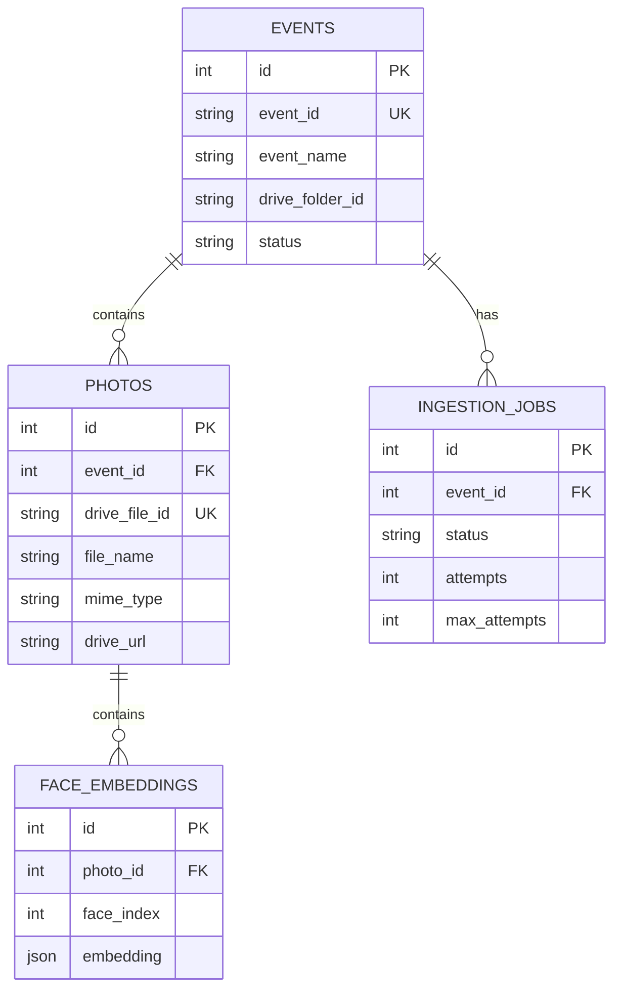
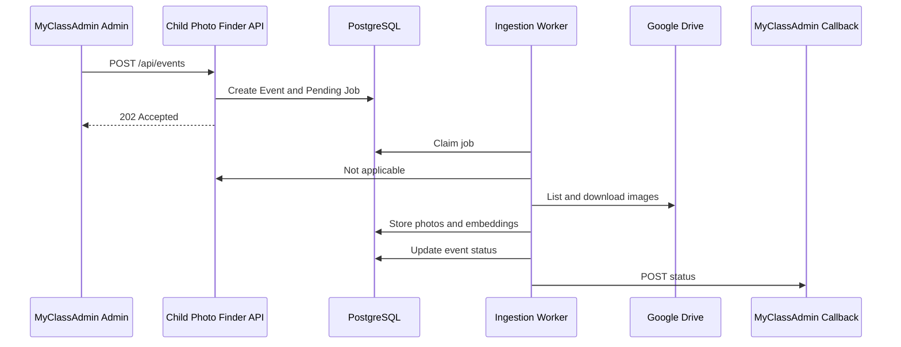
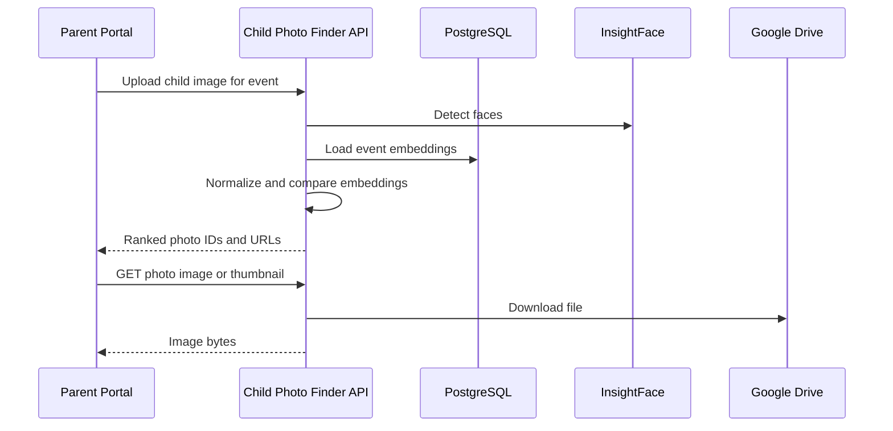
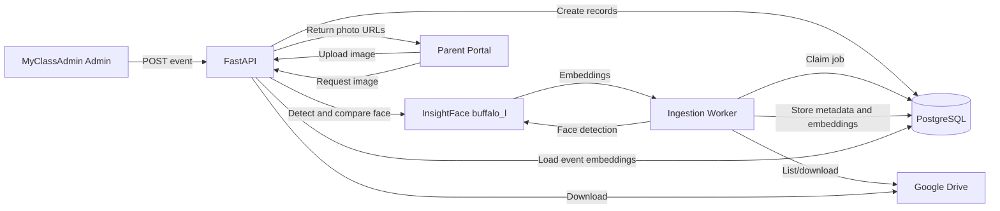
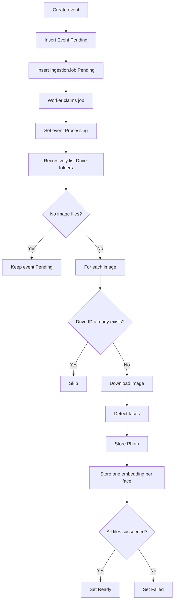

# Child Photo Finder API - Technical Integration Handover

## 1. Complete Project Source Code

### 1.1 Project Purpose

Child Photo Finder is a Python/FastAPI backend that:

1. Creates events associated with MyClassAdmin event IDs and Google Drive folders.
2. Queues and processes event photo ingestion.
3. Detects faces in event photos with InsightFace.
4. Stores normalized face embeddings and photo metadata in PostgreSQL.
5. Searches for a child's photos within one event using cosine similarity.
6. Returns original or thumbnail images through Google Drive.

The repository contains the backend, ingestion worker, face-processing utilities,
and manual test scripts. It does not contain a parent or administrator frontend.

### 1.2 Project Structure

```text
child-photo-finder/
├── main.py
├── requirements.txt
├── .env                         # Not committed
├── credentials/
│   ├── service-account.json     # Not committed
│   ├── google_credentials.json  # Legacy credential file, not used by current Drive service
│   └── token.json               # Legacy OAuth token, not used by current Drive service
├── app/
│   ├── api/routes.py
│   ├── drive/drive_service.py
│   ├── face/face_service.py
│   ├── services/
│   │   ├── event_lock.py
│   │   ├── event_service.py
│   │   ├── ingestion_service.py
│   │   ├── ingestion_worker.py
│   │   └── matching_service.py
│   ├── config.py
│   ├── database.py
│   └── models.py
├── scripts/
│   ├── find_child.py
│   ├── ingest_drive.py
│   └── test_status_callback_mock.py
└── tests/
    └── test_face_service.py
```

### 1.3 File-by-File Description

| File | Responsibility |
| --- | --- |
| `main.py` | Creates the FastAPI application, configures permissive CORS, creates SQLAlchemy tables, and registers `/api` routes. |
| `app/config.py` | Loads `.env` and exposes database, similarity, API-key, and callback settings. |
| `app/database.py` | Creates the SQLAlchemy PostgreSQL engine and session factory. |
| `app/models.py` | Defines SQLAlchemy models for events, photos, face embeddings, and ingestion jobs. |
| `app/api/routes.py` | Implements API-key verification, event creation/deletion, photo retrieval, photo listing, and child search. |
| `app/drive/drive_service.py` | Uses a Google service account to list folders, download original images, and retrieve thumbnails. |
| `app/face/face_service.py` | Loads InsightFace `buffalo_l` and performs CPU face detection and embedding generation. |
| `app/services/ingestion_service.py` | Recursively discovers images, downloads and processes files, updates event/job status, and sends callbacks. |
| `app/services/ingestion_worker.py` | Claims queued jobs, coordinates per-event locking, schedules retries, and detects stale jobs. |
| `app/services/matching_service.py` | Loads event embeddings and performs normalized cosine-similarity matching. |
| `app/services/event_lock.py` | Uses PostgreSQL session-advisory locks to serialize event ingestion and deletion. |
| `app/services/event_service.py` | Empty in the current implementation. |
| `scripts/find_child.py` | Manual command-line face search that creates an HTML results page. |
| `scripts/ingest_drive.py` | Hard-coded manual ingestion utility for one existing Annual Day event. |
| `scripts/test_status_callback_mock.py` | Mock test for MyClassAdmin callback retry behavior. |
| `tests/test_face_service.py` | Manual face-model test script; it is not a complete pytest suite. |

## 2. Requirements / Dependencies

### 2.1 Python Dependencies

| Package | Purpose |
| --- | --- |
| `fastapi` | API framework and automatic OpenAPI documentation. |
| `uvicorn[standard]` | ASGI application server. |
| `python-dotenv` | Loads `.env` configuration. |
| `sqlalchemy` | PostgreSQL ORM and session management. |
| `psycopg2-binary` | PostgreSQL database driver. |
| `pgvector` | Listed dependency for PostgreSQL vector support. The current implementation does not use pgvector and stores embeddings as JSON. |
| `google-api-python-client` | Google Drive API client. |
| `google-auth` | Google authentication support. |
| `google-auth-httplib2` | HTTP transport integration for Google clients. |
| `google-auth-oauthlib` | Listed Google OAuth package. Current Drive code uses service-account credentials, not OAuth flow. |
| `opencv-python` | Decodes image bytes and supplies OpenCV image arrays. |
| `insightface` | InsightFace face detection and face embedding model. |
| `onnxruntime` | ONNX Runtime provider used by InsightFace on CPU. |
| `numpy` | Embedding normalization and cosine-similarity calculations. |
| `python-multipart` | Parses multipart file uploads. |
| `pillow` | Image utility dependency. |
| `requests` | Downloads thumbnails and calls MyClassAdmin status callbacks. |

Install from the repository folder:

```bash
cd child-photo-finder
pip install -r requirements.txt
```

## 3. Models / Frameworks / Model Details

### 3.1 Face Recognition Model

The face model is loaded by `app/face/face_service.py`:

```python
FaceAnalysis(
    name="buffalo_l",
    providers=["CPUExecutionProvider"]
)
```

It is prepared with:

```python
prepare(ctx_id=0, det_size=(640, 640))
```

| Property | Actual implementation |
| --- | --- |
| Framework | InsightFace |
| Model pack | `buffalo_l` |
| Runtime | ONNX Runtime |
| Execution provider | `CPUExecutionProvider` |
| Detection input size | 640 x 640 |
| Model download/loading | InsightFace loads or prepares the model at runtime; no custom model file path is configured in this repository |
| Embedding storage | Python list in SQLAlchemy `JSON` column |

### 3.2 Face Detection Input and Output

`FaceService.detect_faces(image_bytes)`:

1. Converts input bytes to a NumPy `uint8` array.
2. Decodes the image with `cv2.imdecode(..., cv2.IMREAD_COLOR)`.
3. Raises `ValueError("Could not decode image")` when decoding fails.
4. Calls `FaceAnalysis.get(image)`.
5. Returns every detected face as:

```json
{
  "face_index": 0,
  "embedding": [0.0],
  "bbox": [1.0, 2.0, 3.0, 4.0]
}
```

In practice, the embedding length is supplied by the InsightFace model. The
current code does not store face landmarks or image crop coordinates.

### 3.3 Embedding Normalization

Every embedding is divided by its L2 norm in `app/face/face_service.py`:

```text
normalized_embedding = embedding / ||embedding||
```

The same operation is repeated defensively by the matching service.

## 4. API Endpoints Currently Available

All routes under `/api` require `X-API-Key`. `/` and `/health` do not require
authentication.

| Method | Route | Function | Purpose |
| --- | --- | --- | --- |
| `GET` | `/` | `root` | Confirms that the API process is running. |
| `GET` | `/health` | `health` | Health response for monitoring. |
| `POST` | `/api/events` | `create_event` | Create an event and queue ingestion. |
| `DELETE` | `/api/events/{event_id}` | `delete_event` | Delete event database records. |
| `GET` | `/api/events/{event_id}/photos` | `get_event_photos` | List registered photos for an event. |
| `POST` | `/api/events/{event_id}/search` | `search_child` | Search event photos using a child's uploaded image. |
| `GET` | `/api/photos/{photo_id}/image` | `get_photo_image` | Download original photo bytes from Google Drive. |
| `GET` | `/api/photos/{photo_id}/thumbnail` | `get_photo_thumbnail` | Download a thumbnail from Google Drive. |

`GET /api/events` returns all events for the event-selection portal.

## 5. API Request and Response Formats

### 5.1 Authentication

Every `/api` route is protected by a custom header:

```http
X-API-Key: <API_KEY>
```

`app/api/routes.py` compares the header with `API_KEY` from
`app/config.py`.

Invalid or missing authentication returns:

```http
401 Unauthorized
```

```json
{
  "detail": "Invalid or missing API key."
}
```

### 5.2 Create Event

```http
POST /api/events
X-API-Key: <API_KEY>
Content-Type: application/json
```

Request model `EventCreate`:

| Field | Type | Validation |
| --- | --- | --- |
| `event_id` | integer | Must be greater than zero. |
| `event_name` | string | Trimmed; cannot be empty. |
| `drive_link` | string | Google Drive folder URL or folder ID. |

```json
{
  "event_id": 2026,
  "event_name": "Annual Sports Meet 2026",
  "drive_link": "https://drive.google.com/drive/folders/<FOLDER_ID>"
}
```

The service extracts a folder ID from:

- `https://drive.google.com/drive/folders/<FOLDER_ID>`
- A raw folder ID containing no `drive.google.com` text

On success, it creates an `Event` and `IngestionJob` transactionally and returns
HTTP `202 Accepted`:

```json
{
  "message": "Event created and ingestion job queued.",
  "event": {
    "event_id": "2026",
    "event_name": "Annual Sports Meet 2026",
    "status": "Pending"
  },
  "job": {
    "job_id": 12,
    "status": "Pending"
  }
}
```

Idempotency behavior:

- The same event ID, event name, and Drive folder ID returns
  `"Event already exists."` and the latest ingestion job.
- A different event name or Drive folder with the same event ID returns `409`.
- A Drive folder already associated with a different event returns `409`.

Other status responses:

| Status | Cause |
| --- | --- |
| `400` | Empty event name or invalid Drive link. |
| `409` | Duplicate/conflicting event ID or already-used Drive folder. |
| `500` | Event/job database creation failed. |

### 5.3 Delete Event

```http
DELETE /api/events/{event_id}
X-API-Key: <API_KEY>
```

Example:

```bash
curl -X DELETE "https://<API-DOMAIN>/api/events/2026" \
  -H "X-API-Key: <API_KEY>"
```

The `{event_id}` path parameter is converted to a string and matched against
`Event.event_id`.

Success example:

```json
{
  "message": "Event and associated database records deleted successfully.",
  "event_id": 2026,
  "deleted_jobs": 1,
  "deleted_photos": 1034,
  "drive_files_deleted": false
}
```

Deletion removes PostgreSQL ingestion jobs, face embeddings, photos, and the
event itself. It does not delete Google Drive files.

| Status | Cause |
| --- | --- |
| `404` | Event ID not found. |
| `500` | Database deletion failed. |

### 5.4 List Event Photos

```http
GET /api/events/{event_id}/photos
X-API-Key: <API_KEY>
```

Success example:

```json
{
  "event_id": "2026",
  "event_name": "Annual Sports Meet 2026",
  "photo_count": 2,
  "photos": [
    {
      "photo_id": 14,
      "file_name": "IMG_1058.JPG",
      "image_url": "/api/photos/14/image",
      "thumbnail_url": "/api/photos/14/thumbnail"
    }
  ]
}
```

`GET /api/events/{event_id}/photos` returns only photos stored in PostgreSQL.
It does not directly enumerate the Drive folder at request time.

| Status | Cause |
| --- | --- |
| `404` | Event ID not found. |

### 5.5 Search for a Child

```http
POST /api/events/{event_id}/search
X-API-Key: <API_KEY>
Content-Type: multipart/form-data
```

The multipart field name is `file`.

```bash
curl -X POST "https://<API-DOMAIN>/api/events/2026/search" \
  -H "X-API-Key: <API_KEY>" \
  -F "file=@child.jpg"
```

The endpoint:

1. Checks that the event exists.
2. Requires a multipart file whose `content_type` starts with `image/`.
3. Rejects an empty file.
4. Loads and detects faces in memory.
5. Uses the largest face when several faces are found.
6. Returns at most 20 ranked photos.

Success example:

```json
{
  "event_id": "2026",
  "event_name": "Annual Sports Meet 2026",
  "match_count": 2,
  "matches": [
    {
      "photo_id": 14,
      "file_name": "IMG_1058.JPG",
      "similarity": 0.7600321173667908,
      "image_url": "/api/photos/14/image",
      "thumbnail_url": "/api/photos/14/thumbnail"
    },
    {
      "photo_id": 15,
      "file_name": "IMG_1057.JPG",
      "similarity": 0.6708787679672241,
      "image_url": "/api/photos/15/image",
      "thumbnail_url": "/api/photos/15/thumbnail"
    }
  ]
}
```

| Status | Cause |
| --- | --- |
| `400` | Missing/unknown image type, empty image, decode failure, no face detected, or invalid embedding. |
| `404` | Event not found. |
| `500` | Unexpected face-matching failure. |

The API does not store the uploaded child image or create a permanent child
profile.

### 5.6 Retrieve Original Photo

```http
GET /api/photos/{photo_id}/image
X-API-Key: <API_KEY>
```

The route looks up `Photo` by internal database ID, obtains
`drive_file_id`, and calls Google Drive media download.

It returns binary image bytes with `media_type` set to `Photo.mime_type` or
`image/jpeg` as a fallback.

| Status | Cause |
| --- | --- |
| `404` | Photo ID not found. |
| `500` | Google Drive retrieval failed. |

### 5.7 Retrieve Photo Thumbnail

```http
GET /api/photos/{photo_id}/thumbnail
X-API-Key: <API_KEY>
```

The route obtains a Google Drive thumbnail link, replaces or appends an
800-pixel size parameter, and downloads it with a service-account bearer token.

It returns `image/jpeg` bytes.

| Status | Cause |
| --- | --- |
| `404` | Photo ID or thumbnail not found. |
| `500` | Google Drive thumbnail retrieval failed. |

### 5.8 Health Responses

`GET /`:

```json
{
  "message": "Child Photo Finder API is running"
}
```

`GET /health`:

```json
{
  "status": "healthy"
}
```

## 6. Input Processing / Data Registration

### 6.1 Event Registration

The MyClassAdmin integration submits `event_id`, `event_name`, and
`drive_link` to `POST /api/events`.

The system:

1. Rejects empty names.
2. Extracts or validates the Drive folder ID.
3. Converts `event_id` to a public string event ID.
4. Rejects existing IDs with different details.
5. Rejects a folder already assigned to another event.
6. Inserts `Event(status="Pending")`.
7. Inserts `IngestionJob(status="Pending", attempts=0, max_attempts=3)`.
8. Returns `202`.

No event response includes a Drive link or folder ID in the current
implementation, only event ID, name, and status.

### 6.2 Photo Ingestion

`IngestionService.ingest_folder(folder_id, event_id)`:

1. Marks the event `Processing` and sends a callback.
2. Calls `list_files_in_folder()` for the top-level folder.
3. Recursively follows Drive folders.
4. Keeps files whose MIME type begins with `image/`.
5. Skips a file if its `drive_file_id` already exists.
6. Downloads original bytes.
7. Runs face detection.
8. Creates `Photo` metadata.
9. Creates one `FaceEmbedding` per detected face.
10. Commits each photo and its embeddings separately.
11. Marks the event `Ready` when every processed file succeeds.
12. Marks it `Failed` when at least one file failed.

An empty image folder changes the event back to `Pending` and returns
`status="Pending"`; it is not marked `Ready`.

### 6.3 Child Search Input

The child image is read from the multipart request in
`app/api/routes.py` and passed only to `MatchingService.find_matches()`.

No file is persisted to disk or the database. This means the search image cannot
be audited or reused outside the request.

## 7. External API / Third-Party Integrations

### 7.1 Google Drive

Google Drive authentication uses:

```text
credentials/service-account.json
```

`get_drive_credentials()` loads the file using
`google.oauth2.service_account.Credentials.from_service_account_file()`.

The scope is:

```text
https://www.googleapis.com/auth/drive.readonly
```

Drive folders must be shared with the service-account email. The current code
does not support interactive OAuth login. Legacy Google credential and token
files in `credentials/` are ignored by the current `drive_service.py`.

Drive operations:

| Operation | Implementation |
| --- | --- |
| Folder listing | Google Drive `files().list()` with folder parent query and pagination. |
| Recursive folders | `_get_all_image_files()` follows `application/vnd.google-apps.folder`. |
| Original download | `MediaIoBaseDownload`. |
| Thumbnail link | Drive `thumbnailLink`, requested with `=s800`. |

### 7.2 MyClassAdmin Status Callback

`IngestionService._notify_status()` sends:

```http
POST <MYCLASSADMIN_STATUS_URL>
X-API-Key: <MYCLASSADMIN_STATUS_API_KEY>
Content-Type: application/json
```

Payload:

```json
{
  "event_id": 2026,
  "status": "PROCESSING"
}
```

Status mapping:

| PostgreSQL status | Callback status |
| --- | --- |
| `Pending` | `PENDING` |
| `Processing` | `PROCESSING` |
| `Ready` | `READY` |
| `Failed` | `FAILED` |

Callback retries are separate from ingestion-job retries:

- Up to three callback attempts.
- Retried for network errors and HTTP `429`, `500`, `502`, `503`, `504`.
- HTTP `401` or other non-retryable statuses stop immediately.
- Delays are 1 second, then 2 seconds.

The callback mock script passed all four bundled scenarios:

- Success on first attempt.
- HTTP 500 followed by success.
- Stop after three HTTP 500 failures.
- No retry for HTTP 401.

## 8. Database Structure / Tables

### 8.1 Database Technology

- PostgreSQL through `psycopg2-binary`.
- SQLAlchemy ORM.
- `create_all()` is called during API startup.
- No Alembic migration system is present.

### 8.2 `events`

| Field | SQLAlchemy type | Constraints | Description |
| --- | --- | --- | --- |
| `id` | `Integer` | Primary key, indexed | Internal event identifier. |
| `event_id` | `String` | Unique, indexed, not null | Public event ID supplied by MyClassAdmin. |
| `event_name` | `String` | Not null | Event name. |
| `drive_folder_id` | `String` | Not null | Google Drive folder ID. |
| `status` | `String` | Not null | `Pending`, `Processing`, `Ready`, or `Failed`. |
| `created_at` | `DateTime(timezone=True)` | Database default `now()` | Creation timestamp. |

### 8.3 `photos`

| Field | SQLAlchemy type | Constraints | Description |
| --- | --- | --- | --- |
| `id` | `Integer` | Primary key, indexed | Internal photo identifier. |
| `event_id` | `Integer` | Nullable foreign key to `events.id` | Owning event. |
| `drive_file_id` | `String` | Unique, not null | Google Drive file ID. |
| `file_name` | `String` | Not null | Original file name. |
| `mime_type` | `String` | Nullable | Drive MIME type. |
| `drive_url` | `String` | Nullable | Google Drive web-view URL. |
| `created_at` | `DateTime(timezone=True)` | Database default `now()` | Creation timestamp. |

### 8.4 `face_embeddings`

| Field | SQLAlchemy type | Constraints | Description |
| --- | --- | --- | --- |
| `id` | `Integer` | Primary key, indexed | Internal embedding identifier. |
| `photo_id` | `Integer` | Foreign key to `photos.id`, not null | Owning photo. |
| `face_index` | `Integer` | Not null | Detection index within the photo. |
| `embedding` | `JSON` | Not null | Normalized face embedding list. |
| `created_at` | `DateTime(timezone=True)` | Database default `now()` | Creation timestamp. |

### 8.5 `ingestion_jobs`

The source model defines:

| Field | SQLAlchemy type | Constraints | Description |
| --- | --- | --- | --- |
| `id` | `Integer` | Primary key, indexed | Job ID. |
| `event_id` | `Integer` | Foreign key to `events.id`, indexed, not null | Event being processed. |
| `status` | `String` | Indexed, not null | Job status. |
| `attempts` | `Integer` | Not null | Number of attempts claimed. |
| `max_attempts` | `Integer` | Not null | Maximum attempts; set to 3. |
| `next_retry_at` | `DateTime(timezone=True)` | Nullable | Scheduled retry time. |
| `last_error` | `Text` | Nullable | Most recent worker error. |
| `created_at` | `DateTime(timezone=True)` | Not null, database default `now()` | Job creation timestamp. |
| `updated_at` | `DateTime(timezone=True)` | Not null, database default `now()` | Last update timestamp for stale-job recovery. |

The SQLAlchemy model already defines all fields referenced by
`app/services/ingestion_worker.py`. The remaining concern is an existing
PostgreSQL table whose physical columns may not match this model.
`Base.metadata.create_all()` does not alter existing tables.

### 8.6 Relationships



## 9. Environment Variables / Configuration

Create `.env` in `child-photo-finder/`:

```dotenv
DATABASE_URL=postgresql://<USER>:<PASSWORD>@<HOST>:5432/<DATABASE>
SIMILARITY_THRESHOLD=0.45
API_KEY=<RANDOM_LONG_SERVER_SIDE_KEY>
MYCLASSADMIN_STATUS_URL=https://<ADMIN-HOST>/<STATUS-ENDPOINT>
MYCLASSADMIN_STATUS_API_KEY=<CALLBACK_API_KEY>
GOOGLE_DRIVE_FOLDER_ID=
```

| Variable | Required | Current use |
| --- | --- | --- |
| `DATABASE_URL` | Yes | SQLAlchemy engine connection. |
| `SIMILARITY_THRESHOLD` | No | Matching threshold; defaults to `0.45`. |
| `API_KEY` | Yes | API-key validation for `/api` routes. |
| `MYCLASSADMIN_STATUS_URL` | No | Callback destination. |
| `MYCLASSADMIN_STATUS_API_KEY` | No | Callback `X-API-Key`. |
| `GOOGLE_DRIVE_FOLDER_ID` | No for event creation | Loaded but not used by current event routes. |

The service reads `GOOGLE_DRIVE_FOLDER_ID` but event ingestion uses
`drive_folder_id` submitted in `POST /api/events`.

Secrets must not be committed. `.gitignore` excludes `.env`, credential JSON
files, database dumps, data directories, virtual environments, and logs.

## 10. Steps to Run the Project Locally

### 10.1 Prerequisites

- Python 3.11 or compatible Python 3 runtime.
- PostgreSQL.
- Google Cloud service account with Google Drive API access.
- Network access to Google Drive.
- Disk and CPU capacity for InsightFace model loading.

Verified installed development versions:

| Component | Verified version |
| --- | --- |
| Python | 3.11.9 |
| FastAPI | 0.120.2 |
| Uvicorn | 0.38.0 |
| SQLAlchemy | 2.0.43 |
| Pydantic | 2.13.3 |
| OpenCV | 4.12.0.88 |
| NumPy | 1.26.4 |
| Pillow | 10.1.0 |
| ONNX Runtime | 1.23.2 |
| InsightFace | 1.0.1 |

### 10.2 Clone and Setup

```bash
git clone <REPOSITORY_URL>
cd child-photo-finder
python -m venv .venv
```

Windows:

```powershell
.\.venv\Scripts\Activate.ps1
pip install -r requirements.txt
```

Linux/macOS:

```bash
source .venv/bin/activate
pip install -r requirements.txt
```

### 10.3 Configure PostgreSQL

Create a PostgreSQL database and user, then set `DATABASE_URL`.

The API calls `Base.metadata.create_all(bind=engine)` at startup. This creates
tables missing in a database, but it does not update an existing table schema.

Before starting the current worker, ensure the database schema contains every
column referenced by `app/services/ingestion_worker.py`.

### 10.4 Configure Google Drive

Place the service-account key at:

```text
credentials/service-account.json
```

Share event folders with the service-account email and grant at least read
access.

Do not expose or commit the JSON key.

### 10.5 Start the API

```bash
uvicorn main:app --reload --host 127.0.0.1 --port 8000
```

Open:

- API: `http://127.0.0.1:8000`
- Swagger: `http://127.0.0.1:8000/docs`
- OpenAPI JSON: `http://127.0.0.1:8000/openapi.json`

### 10.6 Start the Ingestion Worker

In a separate process:

```bash
python -m app.services.ingestion_worker
```

The worker must remain running for queued ingestion jobs to be processed.
Starting only `uvicorn` does not process jobs.

## 11. Programming Language and Framework Versions

### 11.1 Verified Versions

The versions below were verified from the active environment:

- Python 3.11.9
- FastAPI 0.120.2
- Uvicorn 0.38.0
- SQLAlchemy 2.0.43
- Pydantic 2.13.3
- OpenCV 4.12.0.88
- NumPy 1.26.4
- InsightFace 1.0.1
- ONNX Runtime 1.23.2
- Pillow 10.1.0
- Requests 2.32.5

Version numbers are not pinned in `requirements.txt`; future installs can
resolve newer compatible or incompatible packages unless dependency locking is
introduced.

## 12. Sample API Requests / Responses

### 12.1 Create Event

```bash
curl -X POST "https://<API-DOMAIN>/api/events" \
  -H "X-API-Key: <API_KEY>" \
  -H "Content-Type: application/json" \
  -d '{
    "event_id": 2026,
    "event_name": "Annual Sports Meet 2026",
    "drive_link": "https://drive.google.com/drive/folders/<FOLDER_ID>"
  }'
```

### 12.2 Search Child

```bash
curl -X POST "https://<API-DOMAIN>/api/events/2026/search" \
  -H "X-API-Key: <API_KEY>" \
  -F "file=@child.jpg"
```

### 12.3 List Event Photos

```bash
curl "https://<API-DOMAIN>/api/events/2026/photos" \
  -H "X-API-Key: <API_KEY>"
```

### 12.4 Retrieve Original and Thumbnail

```bash
curl "https://<API-DOMAIN>/api/photos/14/image" \
  -H "X-API-Key: <API_KEY>" \
  --output photo.jpg

curl "https://<API-DOMAIN>/api/photos/14/thumbnail" \
  -H "X-API-Key: <API_KEY>" \
  --output thumbnail.jpg
```

### 12.5 Delete Event

```bash
curl -X DELETE "https://<API-DOMAIN>/api/events/2026" \
  -H "X-API-Key: <API_KEY>"
```

## 13. Frontend / UI Integration

### 13.1 Frontend Status

No frontend application or frontend framework source is present in this
repository. The backend is intended to integrate with MyClassAdmin.

### 13.2 Admin Integration Flow



The frontend/admin team should:

1. Submit MyClassAdmin event ID as `event_id`.
2. Submit `event_name`.
3. Submit a valid Google Drive folder URL or folder ID.
4. Handle HTTP `202` as queued, not completed.
5. Use MyClassAdmin callback status updates instead of assuming ingestion has
   finished immediately.

There is no implemented `GET /api/events` endpoint for loading a complete event
list or Drive link.

### 13.3 Parent Portal Flow



The frontend integration must:

- Send event ID in the URL.
- Send the image as multipart field `file`.
- Display `match_count` and `similarity`.
- Use `thumbnail_url` for galleries.
- Use `image_url` for full-size viewing/download.
- Handle `400`, `404`, `401`, and `500` responses.

## 14. How the Core Functionality Works

### 14.1 Architecture



### 14.2 Event Ingestion Algorithm



### 14.3 Cosine-Similarity Matching

For query embedding `q` and stored embedding `s`:

```text
q_hat = q / ||q||
s_hat = s / ||s||
similarity = dot(q_hat, s_hat)
```

Because both vectors are normalized, the dot product is cosine similarity.

The default threshold is `0.45`, loaded from `SIMILARITY_THRESHOLD`.

Matching steps:

1. Detect all faces in the uploaded child image.
2. If multiple faces exist, sort by bounding-box area and choose the largest.
3. Convert the chosen embedding to `float32`.
4. Normalize the query again.
5. Load every `FaceEmbedding` joined to a `Photo` belonging to the selected
   event.
6. Normalize each stored embedding.
7. Calculate dot product.
8. Skip similarities below `0.45`.
9. Keep the highest similarity for each photo.
10. Sort photo matches descending.
11. Return the first 20.

### 14.4 Worker State Behavior

The worker's constants are:

| Item | Value |
| --- | --- |
| Worker polling interval | 3 seconds |
| Worker retry delay | 10 seconds multiplied by `2^(attempt-1)` |
| Stale processing threshold | 15 minutes |
| Maximum attempts | 3 |

Eligible jobs include:

- `Pending`
- `Retrying` whose retry time is `NULL` or reached
- `Processing` whose update time is older than 15 minutes

Jobs are claimed with PostgreSQL `FOR UPDATE SKIP LOCKED`.

The worker locks an event using `pg_advisory_lock(<internal event id>)` during
ingestion and deletion coordination.

## 15. Pending Issues / Current Limitations

### 15.1 Implemented vs Not Implemented

| Item | Status |
| --- | --- |
| Event creation | Implemented |
| Event deletion | Implemented |
| Event photo listing | Implemented |
| Child photo search | Implemented |
| Original photo retrieval | Implemented |
| Thumbnail retrieval | Implemented |
| Separate child registration | Not implemented |
| Permanent child-image storage | Not implemented |
| Event list endpoint | Not implemented |
| Frontend application | Not implemented in this repository |
| Vector database/pgvector search | `pgvector` is listed, but matching uses in-memory NumPy |
| Database migrations | Not implemented |

### 15.2 Existing Database Schema Verification

The `IngestionJob` model and `app/services/ingestion_worker.py` already agree
on the required fields. However, an existing PostgreSQL table can still be
missing these columns if it was created from an older model or manually.

Before production deployment, verify or run
`scripts/migrate_ingestion_jobs.py`. `Base.metadata.create_all()` will not add
missing columns to an existing table.

### 15.3 Script Inconsistency

`scripts/ingest_drive.py` contains hard-coded values:

- Folder ID `1j2Sb5wFEw2l7Hnf3CY1soxIuOSqrtIJD`
- Public event ID `EVT002`

This script will not follow the current MyClassAdmin numeric-event workflow
unless corresponding records exist.

`scripts/find_child.py` defaults to event ID `EVT001`, which may not match
new numeric event IDs.

### 15.4 Testing Limitations

- `tests/test_face_service.py` is a manual script.
- It loads the full face model and uses `data/temp/test_image.jpg`.
- The repository does not contain a complete pytest API or database suite.
- The callback mock script passed its four callback retry scenarios.
- A full test-suite run was stopped during ML dependency initialization and
  is not reported as passed.

### 15.5 Performance and Scalability

- Search loads all matching event embeddings and compares them in Python/NumPy.
- No pgvector index or ANN index is currently used.
- Each photo/embedding is committed individually during ingestion.
- One ingestion worker loop is implemented; no distributed worker locking
  across multiple worker processes is provided beyond the SQL job claim and
  PostgreSQL event advisory lock.
- InsightFace model initialization creates a model instance separately in
  ingestion and matching service objects.

### 15.6 Security

- CORS allows every origin and does not expose credentials through browser
  cookies because `allow_credentials=False`.
- API keys should remain server-side and should not be embedded in browser JavaScript.
- Production CORS origins should be restricted.
- HTTPS should terminate at the reverse proxy or hosting platform.
- Service-account JSON, `.env`, database URLs, and API keys must remain outside Git.
- The API and callback keys are plain shared keys with no rotation mechanism
  implemented.
- There is no upload size limit in the current code.
- Image MIME type is based on the multipart header, not file-signature validation.
- No rate limiting is implemented.

### 15.7 Production Data and Storage

- Original and thumbnail photos remain in Google Drive.
- PostgreSQL stores file names and IDs but not image binaries.
- A missing or revoked Drive permission causes image retrieval failures.
- The deletion endpoint does not delete Google Drive files.
- Child images used for search are not persisted.

### 15.8 Deployment Readiness Improvements

Before production deployment:

1. Verify or migrate existing `ingestion_jobs` columns.
2. Add migrations rather than relying only on `create_all()`.
4. Pin dependency versions.
5. Add automated API, worker, database, callback, and face-model tests.
6. Add upload size limits and stronger image validation.
7. Restrict CORS origins.
8. Add HTTPS and secrets management.
9. Add rate limiting and request logging without logging secrets.
10. Consider a vector index if event datasets become large.

## 16. Short Deployment Section

For the standalone deployment procedure, see `DEPLOYMENT.md`.

### 16.1 Deployment Architecture

Deploy two supervised processes:

1. FastAPI API process: handles HTTP requests.
2. Ingestion worker process: polls PostgreSQL and processes queued jobs.

Both processes must use the same database and Google service-account
configuration.

### 16.2 Server Preparation

```bash
cd child-photo-finder
python3 -m venv .venv
source .venv/bin/activate
pip install -r requirements.txt
```

Configure:

- PostgreSQL and `DATABASE_URL`.
- `.env`.
- `credentials/service-account.json`.
- Google Drive folder sharing.
- MyClassAdmin callback URL and key, if callbacks are enabled.

On Linux:

```bash
chmod 600 .env credentials/service-account.json
```

### 16.3 Start the API

Run Uvicorn behind a TLS-terminating reverse proxy or hosting platform:

```bash
uvicorn main:app --host 0.0.0.0 --port 8000 --workers 2
```

The reverse proxy should forward traffic to port `8000`, terminate HTTPS,
and expose `/health` for health checks.

### 16.4 Start the Worker

```bash
python -m app.services.ingestion_worker
```

Use systemd, Supervisor, Docker, Kubernetes, or the hosting platform to keep
the worker running and restart it after failure.

### 16.5 Production Verification

Verify the deployment with:

```bash
curl https://<API-DOMAIN>/health

curl -X POST "https://<API-DOMAIN>/api/events" \
  -H "X-API-Key: <API_KEY>" \
  -H "Content-Type: application/json" \
  -d '{
    "event_id": 2026,
    "event_name": "Deployment Test",
    "drive_link": "https://drive.google.com/drive/folders/<TEST_FOLDER_ID>"
  }'
```

Confirm:

1. The event and job are stored in PostgreSQL.
2. The worker claims the job.
3. The event status changes through `Pending -> Processing -> Ready/Failed`.
4. MyClassAdmin receives callback status updates, if configured.
5. Event photo listing and child search return the expected results.

### 16.6 Deployment Checklist

- Verify or migrate existing `ingestion_jobs` columns.
- Migrate PostgreSQL explicitly.
- Back up PostgreSQL.
- Keep all secrets outside source control.
- Deploy API and worker as separate supervised processes.
- Restrict CORS in production.
- Enable HTTPS.
- Monitor API logs, worker logs, callback failures, Drive permissions, and
  database capacity.
- Restart the worker safely after deployment; stale processing jobs are
  reclaimed after 15 minutes.
